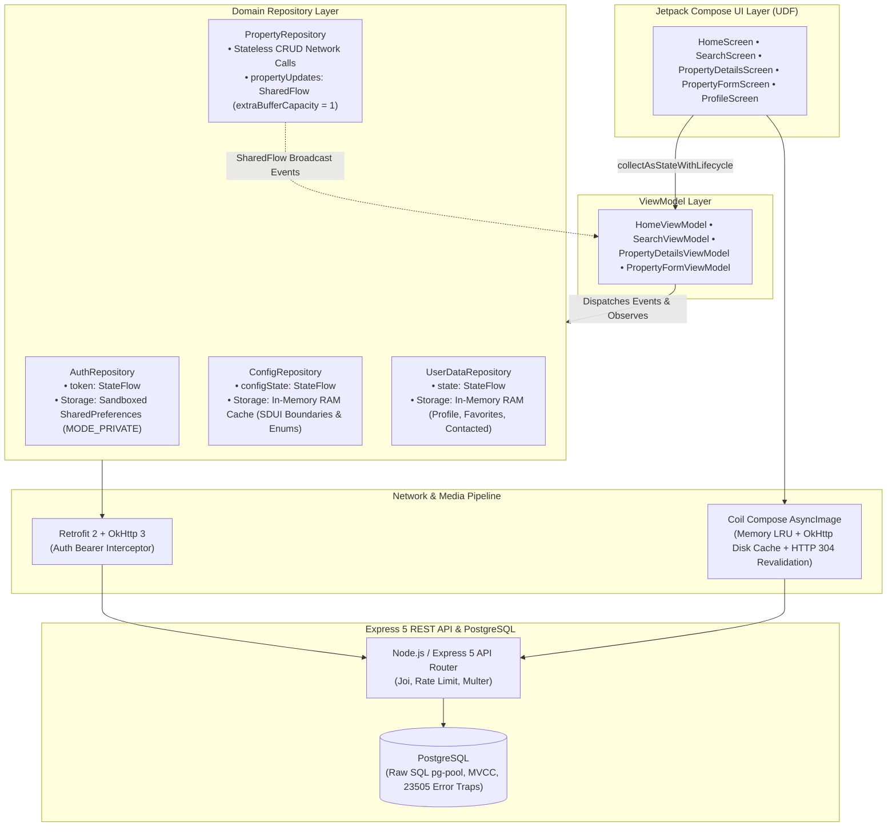
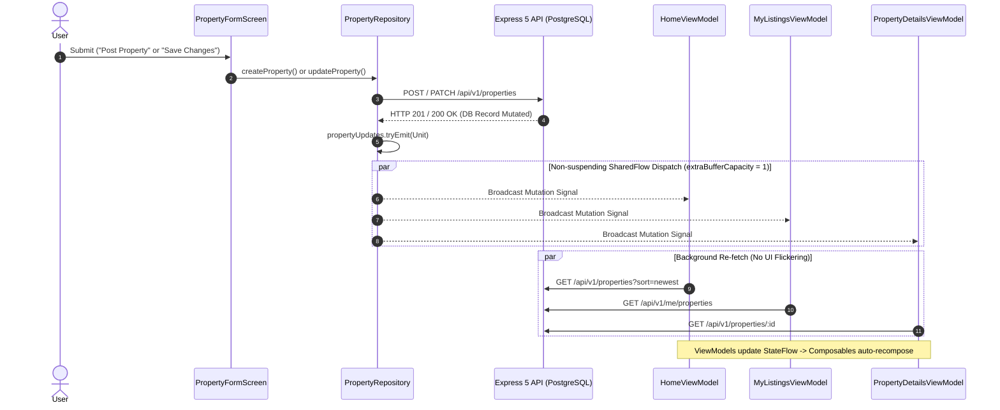

# Rentals

A full-stack, multi-client real estate listing and search platform pairing an **Express 5 REST API** and **PostgreSQL** database with a native **Android client (Jetpack Compose)** and a companion **React Web SPA**, enforcing strict **DTO contract parity** across unified domain models.

The architecture prioritizes *strict separation of concerns*, *reactive state synchronization*, *server-driven configuration (SDUI)*, and *database-level concurrency control*.

---

## Tech Stack

* **Android Client:** Kotlin, Jetpack Compose (Material 3), ViewModel, Coroutines, StateFlow & SharedFlow, Retrofit 2, OkHttp 3, Coil Compose, Navigation Compose
* **Web Client:** React, Vite, React Router, Axios, CSS (Custom Properties & Flexbox)
* **Backend:** Node.js, Express 5, Joi, JWT, express-rate-limit, Multer
* **Database:** PostgreSQL (raw parameterized SQL via `pg` pool)

---

## Architecture Overview (Android)

The native Android client is built on **Unidirectional Data Flow (UDF)** and the **MVVM** pattern. UI composables are strictly decoupled from network operations and database calls through lifecycle-aware Kotlin Flows and singleton domain repositories.

### 1. Domain Repository & MVVM Topology



---

### 2. Reactive Mutation Loop (`SharedFlow` Event Bus)

When an owner creates, updates, or deletes a listing in `PropertyFormScreen` or `PropertyDetailsScreen`, `PropertyRepository` broadcasts a lightweight refresh signal across its `propertyUpdates` stream. Active ViewModels across the back-stack collect this event to synchronize their states in the background, eliminating stale UI data and fragile navigation back-stack listeners.



---

## Multi-Client Architectural Mapping

Both clients consume the exact same backend endpoints and adhere to unified domain boundaries:

| Architectural Concern     | React Web Client                                       | Native Android Client (Jetpack Compose)                             |
| :------------------------ | :----------------------------------------------------- | :------------------------------------------------------------------ |
| **State Management**      | Context Providers (`AuthProvider`, `UserDataProvider`) | Singleton Domain Repositories (`StateFlow`, `SharedFlow`)           |
| **Network Client**        | Axios instance with auth interceptor                   | Retrofit 2 + OkHttp 3 with logging & auth interceptors              |
| **Session Persistence**   | `localStorage` with lazy initial state evaluation      | Sandboxed `SharedPreferences (MODE_PRIVATE)`                        |
| **Image Pipeline**        | Native `` with browser cache                      | Coil `AsyncImage` (LRU memory + disk cache + HTTP 304 revalidation) |
| **Design System**         | CSS Custom Properties (`:root` variables)              | Centralized Design System (`Color.kt`, `Theme.kt`, `Type.kt`)       |
| **Client Routing**        | `react-router-dom` declarative route paths             | Navigation Compose with centralized `Routes.kt` builders            |
| **Lifecycle Integration** | `useEffect` dependency array & cleanup functions       | `collectAsStateWithLifecycle()` pausing on backgrounded states      |

---

## Key Architectural Decisions & Engineering Highlights

### Multi-Client Core & State Governance
- **Multi-Client Architecture & DTO Contract Parity:** A unified Express/PostgreSQL backend serves both the React Web SPA and the native Android application. Both clients enforce identical domain models, validation constraints, and standardized API error envelopes.
- **Domain-Driven Data Layer:** Application state is strictly partitioned across three stateful domains (`Auth`, `Config`, `UserData`) and one stateless execution domain (`PropertyRepository`). Screen ViewModels interact only with the specific domain repositories they require.
- **Online-Only Property Data:** Listings are fetched in real-time without offline caching, ensuring users never view or attempt to contact owners of stale or deleted listings.
- **Storage Tiering Rationale:**
  * **Auth Session (Disk):** Persisted across process death via `localStorage` (Web) and sandboxed `SharedPreferences (MODE_PRIVATE)` (Android), isolating JWT tokens at the OS process boundary.
  * **Application Config (RAM):** Global options, cities, and validation schemas are fetched once at launch and held in memory via `ConfigRepository` to eliminate redundant network roundtrips.
  * **Lazy Initialization & Recomposition Isolation:** React Contexts use lazy evaluation (`useState(() => localStorage.getItem('token'))`) to eliminate synchronous disk reads on re-renders. On Android, initialization runs strictly once inside Kotlin Singleton Repositories, isolating disk reads and memory allocations from Compose recomposition cycles.

### Android Client Engineering
- **Event-Driven Mutation Stream (`SharedFlow`):** Property mutations (`createProperty`, `updateProperty`, `deleteProperty`) broadcast a refresh signal across `PropertyRepository.propertyUpdates`. Configured with `extraBufferCapacity = 1`, it dispatches non-suspending `tryEmit()` calls without blocking callers or dropping events. Active ViewModels across the back-stack collect this event to update listings in the background without navigation back-stack listeners.
- **Server-Driven UI (SDUI) Validation:** Form boundaries, min/max limits, and field requirements are not hardcoded on the client. The Android app fetches schema rules dynamically from `/api/v1/config` (cached in memory by `ConfigRepository`), automatically driving input bounds, default values, and dynamic required asterisks (`*`) across forms.
- **Lifecycle-Aware State Collection:** Composables observe repository and ViewModel flows strictly through `collectAsStateWithLifecycle()`. This automatically halts collection when screens drop below the `STARTED` lifecycle state (e.g., app backgrounded or screen covered), preventing memory leaks and CPU waste.
- **HTTP-Aware Multi-Tier Media Pipeline:** Image loading leverages Coil Compose backed by a dual-tier cache: an in-memory LRU Bitmap cache for zero-latency recompositions, and an on-disk cache integrated with OkHttp. The client respects backend HTTP caching semantics (`Cache-Control: max-age=86400` and `ETags`), performing conditional requests (`If-None-Match`) that resolve to `HTTP 304 Not Modified` to minimize cellular data consumption.
- **Encapsulated Route Contracts & Back-Stack Policies:** Screen routing avoids fragmented string concatenation across UI composables. Navigation routes and argument paths are managed through centralized contract helpers in `Routes.kt` (e.g., `Routes.details(id: String)`). Back-stack clearing behaviors (`navigateHomeAfterAuth()`, `navigateHomeAndClearStack()`) encapsulate `popUpTo(Routes.HOME) { inclusive = false }` rules, ensuring authentication and listing creation flows terminate cleanly without leaving stale screens on the back-stack.
- **Unified Add/Edit Form Lifecycle:** A single `PropertyFormScreen` and `PropertyFormViewModel` handle both creation and editing flows, detecting mode via `SavedStateHandle`. The form seamlessly manages mixed media—retaining existing remote photo strings while staging newly selected local gallery `Uri` items for multipart dispatch.

## Backend System Design

- **Server-Driven Configuration & Validation (SDUI):** A centralized `/config` endpoint dictates client behavior by delivering static options, single-field validation limits, and complex cross-field constraints (e.g., ensuring `floor_no <= total_floors`, and requiring at least one tenant preference).
- **Dual-Layer Config Caching:** The config payload is cached in a server-side Node.js memory variable to eliminate repetitive SQL queries, and served with a 24-hour HTTP `Cache-Control` header for client-side caching.
- **Resilient PATCH Normalization:** A dedicated middleware (`normalizePropertyUpdate.js`) merges partial client updates with the existing database record. This allows the centralized Joi validation middleware to strictly enforce the exact same schema (rejecting unknown parameters) for both POST and PATCH requests, ensuring controllers receive a standardized, fully validated object.
- **Data Minimization & Sliding-Window Rate Limiting:** Public property endpoints strictly strip sensitive owner details (name, phone, email) to prevent scraping. Contact details are unlocked exclusively through an authenticated request to `/properties/:id/contact`, protected by a user-scoped limit of 10 requests per 24 hours. Rate-limited requests return HTTP `429 Too Many Requests` alongside a precise reset timestamp to drive dynamic client countdown tickers. Contact responses include `Cache-Control: no-store` to prevent caching sensitive personal data.
- **RESTful Search & Query Parameterization:** Query parameters (e.g., `GET /properties?cityId=1&rentMax=15000`) are dynamically translated into PostgreSQL `ANY()` clauses and `>=` conditions. All dynamic values execute strictly as parameterized queries via the `pg` pool to prevent **SQL Injection**, ensuring filtering occurs securely at the database level.
- **Media Lifecycle & Storage Purging:** Uploads are processed via Multer, capped at 5MB, and namespaced by user ID. Property photos are served via `express.static` with 24-hour cache headers (`maxAge: '1d'`). When an owner removes a photo during an edit or deletes a property entirely, the server automatically purges the corresponding image files from disk to prevent storage leaks. Runtime-uploaded files matching `user_*` are excluded via `.gitignore`, preserving seed fixture images.
- **Native Async Routing & Two-Tier TOCTOU Defense:** Leveraged Express 5's native asynchronous routing to maintain clean controllers without redundant `try/catch` wrappers. Implemented a strict defense against concurrent race conditions (Time-of-Check to Time-of-Use) using a two-tier boundary:
  * **Tier 1 (Controller-Level Check):** Executes an upfront `SELECT` query to provide immediate feedback for standard duplicate requests.
  * **Tier 2 (Database-Level Fallback):** A centralized error middleware intercepts PostgreSQL constraint violations (specifically error code `23505` for unique violations) and translates them into predictable HTTP `409 Conflict` responses, handling microscopic concurrent inserts safely.

## Database Architecture

- **Normalized Relational Schema:** Designed normalized schemas in PostgreSQL for 5 core entities. Referential integrity utilizes `ON DELETE CASCADE` to clean up user-owned records (favorites, listings), while strictly applying `ON DELETE RESTRICT` to core reference data (e.g., `cities`) to prevent catastrophic cascading data loss.
- **Concurrency & Idempotency:** Leveraged PostgreSQL's native MVCC (Multi-Version Concurrency Control) to prevent read/write blockages during high-traffic search queries. Ensured API idempotency and prevented race conditions (e.g., duplicate favorites or repeated contact requests) using composite primary keys paired with `ON CONFLICT DO NOTHING`.
- **Query Optimization:** Implemented explicit B-tree indexing on foreign keys (`owner_id`, `property_id`) and search parameters (`rent`, `bedrooms`, `city_id`) to optimize query execution time.
- **Immutable Contact History:** Deliberately omitted the `properties(id)` foreign key constraint in the contact history table. This ensures user lifetime contact metrics and historical interactions remain intact, even if a landlord deletes the original listing.

## Features

- **Authentication & Identity:** User signup and login with secure JWT token issuance and sandboxed storage.
- **Real-Time Property Feed:** Multi-filter search by city, property type, rent range, minimum bedrooms/bathrooms, and tenant rules.
- **Dedicated Property Details View:**
  * **Interactive Media Gallery:** Multi-image preview with thumbnail selector and cached remote asset loading.
  * **Role-Adaptive Actions:** Contextual UI adapting between unauthenticated visitors (login prompt), authenticated renters (rate-limited owner contact reveal with live countdown), and property owners (edit/delete management).
  * **Listing Specifications:** Displays structural metadata, furnishing status, deposit terms, and tenant preference requirements.
- **Listing Management:** Landlords can publish, update, and delete property listings with automated photo cleanup on the server.
- **Rate-Limited Contact Inquiries:** 10 owner contacts per user every 24 hours with live frontend cooldown tickers.
- **User Dashboard & Collections:** Dedicated reactive collections for Favorites, Contacted properties, and My Listings.

---

## Project Structure

```text
rentals/
├── backend/
│   ├── controllers/         # API route handlers and business rules
│   ├── middlewares/         # Global error handler, auth, Joi validate, rate limiting, custom logger
│   ├── routes/              # Express 5 routers mapping endpoints to controllers
│   ├── validators/          # Joi schemas for request body/query validation
│   ├── db/                  # PostgreSQL connection pool and schema definitions
│   ├── scripts/             # Database seeder scripts
│   └── public/images/       # Static property photos (runtime user_* git-ignored)
├── web/
│   └── src/
│       ├── components/      # Reusable UI components (PropertyCard, PropertyList, etc.)
│       ├── screens/         # Page-level screens (Home, Search, Details, Form, Profile)
│       ├── context/         # React Context definitions
│       ├── providers/       # State management (AuthProvider, UserDataProvider, ConfigProvider)
│       └── services/        # Axios API configuration and network endpoints
└── android/
    └── app/src/main/java/com/rentals/app/
        ├── data/
        │   ├── api/         # Retrofit ApiClient, ApiService interface, error mappers
        │   ├── models/      # SDUI config models, Property, User, and Owner entities
        │   └── repository/  # AuthRepository, ConfigRepository, PropertyRepository, UserDataRepository
        ├── ui/
        │   ├── components/  # Reusable UI composables (PropertyCard, PropertyList, CollectionHeader)
        │   ├── navigation/  # AppNavGraph, Routes contracts, and back-stack helpers
        │   ├── screens/     # Feature screens (home, search, propertydetails, propertyform, auth)
        │   └── theme/       # Central design system (Theme.kt, Color.kt, Type.kt)
        └── MainActivity.kt  # Single-Activity entry point hosting AppNavGraph
```

---

## API Reference

Base URL: `/api/v1`

> *Note on Contract Parity: Both the React SPA (`services/api.js`) and native Android client (`ApiService.kt`) consume 100% of these endpoints, sharing unified DTO structures, status code semantics, and error envelopes.*

| Domain         | Method   | Endpoint                    | Auth   | Purpose                                           |
| :------------- | :------- | :-------------------------- | :----- | :------------------------------------------------ |
| **Metadata**   | `GET`    | `/config`                   | Public | Cached SDUI rules, field boundaries & constraints |
| **Auth**       | `POST`   | `/auth/signup`              | Public | Register new user account                         |
|                | `POST`   | `/auth/login`               | Public | Authenticate user and issue JWT                   |
| **Properties** | `GET`    | `/properties`               | Public | Multi-filter search and listing feed              |
|                | `GET`    | `/properties/:id`           | Public | Property details (omits sensitive owner details)  |
|                | `POST`   | `/properties`               | User   | Create listing (auto-generates title)             |
|                | `PATCH`  | `/properties/:id`           | Owner  | Normalized partial update with photo diffing      |
|                | `DELETE` | `/properties/:id`           | Owner  | Delete listing & purge owner photo files          |
|                | `GET`    | `/properties/:id/contact`   | User   | Reveal owner contact (Rate limit: 10/day)         |
| **User State** | `GET`    | `/me`                       | User   | Profile, lifetime contact stats, and activity     |
|                | `GET`    | `/me/properties`            | User   | Listings published by authenticated user          |
|                | `GET`    | `/me/favorites`             | User   | Favorited listings with total count               |
|                | `POST`   | `/me/favorites/:propertyId` | User   | Toggle favorite status                            |
|                | `GET`    | `/me/contacted`             | User   | History of active contacted listings              |
| **Media**      | `POST`   | `/upload`                   | User   | Upload up to 5 photos (multipart field `photos`)  |
|                | `GET`    | `/images/:filename`         | Public | Deliver static property photos (24h cache)        |

---

## Local Development Setup

<details>
<summary><strong>Click to expand instructions</strong></summary>

**1. Install Backend & Web Dependencies**

Open two separate terminals from the root `rentals` project folder:

**Terminal 1 (Backend):**
```bash
cd backend
npm install
```

**Terminal 2 (Frontend):**
```bash
cd web
npm install
```

---

**2. Connect to PostgreSQL**
Open the PostgreSQL command line client on your operating system:

- **Linux:** `sudo -u postgres psql`
- **macOS:** `psql postgres`
- **Windows:** Open SQL Shell (`psql`) or connect via pgAdmin.

---

**3. Create User & Database**
Inside the `psql` console, run:
```sql
CREATE USER your_username WITH PASSWORD 'your_password';
CREATE DATABASE rentals OWNER your_username;
\q
```

---

**4. Configure Environment**
In the `backend` directory, copy `.env.example` to `.env`:

```bash
# Linux / macOS:
cp .env.example .env

# Windows (Command Prompt / PowerShell):
copy .env.example .env
```

Generate a secure JWT secret:
```bash
node -e "console.log(require('crypto').randomBytes(32).toString('hex'))"
```

Update `backend/.env` with your PostgreSQL credentials and generated secret:
```env
PORT=8000
DB_USER=your_username
DB_HOST=localhost
DB_NAME=rentals
DB_PASSWORD=your_password
DB_PORT=5432
SECRET_STR=<paste_generated_secret_here>
```

---

**5. Initialize Schema & Seed Data**
Execute the schema migration and run the seeder from the `backend` directory:
```bash
psql -U your_username -d rentals -f db/schema.sql
node scripts/seed.js
```

---

**6. Android Client Setup**

Gradle reads `API_BASE_URL` from `android/local.properties` during configuration and injects it into `BuildConfig.API_BASE_URL` at compile time.

Create or update `android/local.properties`:

```properties
# Path to Android SDK
sdk.dir=/home/your_username/Android/Sdk

# Scenario A: Physical Device via Mobile Hotspot (Laptop connected to Phone Hotspot)
# Use your laptop's assigned IP on the hotspot subnet:
API_BASE_URL=http://192.168.43.150:8000/api/v1/

# Scenario B: Physical Device via Local Wi-Fi (Both devices on same router)
# Use your laptop's local LAN IP:
# API_BASE_URL=http://192.168.1.45:8000/api/v1/

# Scenario C: Android Studio Emulator
# 10.0.2.2 is the emulator's alias pointing to host machine localhost:
# API_BASE_URL=http://10.0.2.2:8000/api/v1/
```

---

**7. Run the Applications**

**Terminal 1 (Backend API):**
```bash
cd backend
npm start
```

**Terminal 2 (Web Client):**
```bash
cd web
npm run dev
```

The web application will be accessible at `http://localhost:5173`.

**Android Client:**
With USB debugging enabled on your physical device or with an emulator running:
```bash
cd android
./gradlew installDebug
```

</details>
